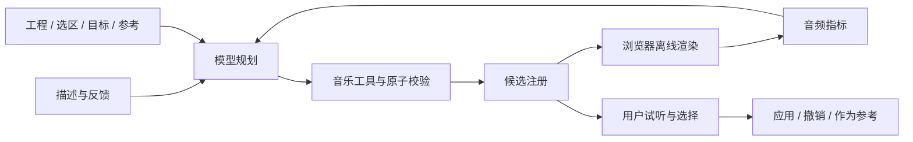

# 音乐创作 Agent 实现

2026-10-08。目标是帮助用户探索音色、发展动机、理解和声；所有修改先形成候选，由用户决定应用。

## 执行路径

网页提交工程快照、稳定选区 ID、对话、目标、明确偏好以及至多3个参考候选。网关通过兼容 chat-completions 的模型接口循环执行工具。局部操作编译为一次性补丁，原子校验边界、锁定、选区和版本后注册候选。模型最终只能返回本轮注册的 candidateIds；跳过注册或编造 ID 会失败。

工具生成的音符 ID 在注册时固定，应用时不会重新生成。工程v1/v2在读取时迁移到v3；v3要求稳定 ID，重复 ID 被拒绝。节奏锁定按 ID 比较时序和力度，数组排序变化不会造成误定位。选区允许修改或删除其中的音符，禁止添加音符和改变选区外音符。

## 工具

| 工具 | 输入与作用 |
|---|---|
| get_project_context | 工程、稳定 ID、硬性锁定、选区、用户目标/偏好和参考 |
| analyze_music | 音符数、相邻音程、密度、末音所在和弦；符号分析 |
| edit_sound | values：局部音色参数，输出可注册操作 |
| transform_motif | noteIds、transpose/set_pitch/stretch、amount；输出校验后的操作 |
| edit_chords | add/update/delete_chord 操作；校验和弦边界与锁定 |
| propose_edit | title、explanation、baseRevision、operations；注册候选 |
| render_preview | candidateId；请求浏览器实渲染并反馈指标 |
| compare_candidates | 2–3个合法候选 ID；返回参数、符号和可用音频指标 |
| compose_candidates | 用户参考或本轮候选的音色/旋律/和声 ID；组合成新候选 |

旧 patch 提案仅为内部规则演示、原有约束测试和 direct 对照保留兼容路径；模型工具定义使用局部 operations。

支持的操作为 update/add/delete_note、update/add/delete_chord、set_sound_parameters、set_layers、set_bars。所有操作在同一草稿顺序执行，最终状态统一校验；任何失败都不修改用户工程。sound顶层可部分修改，嵌套对象与数组仍完整替换；高级参数可从上下文读取后保留未修改值。工程的速度和锁定由界面手动控制。

## 浏览器音频桥

POST /api/runs创建有45秒预算的任务，返回随机 runId 与访问 token。网页每400ms查询任务状态；render_preview产生有唯一 jobId 的待执行工作。网页用 OfflineAudioContext渲染候选前至多4小节，并将指标 POST 到 /api/runs/:id/tool-results。模型等待指标后可以继续规划。候选最终返回前，如尚未渲染，网关请求补渲染；这一步的指标不会逆向改写模型已完成的文字说明。

结果必须匹配当前等待的 jobId；重复、过期或取消后的结果拒绝。token随 Authorization 头传输。取消、页面退出或手动改变工程会取消任务；工程版本检查再次防止旧补丁覆盖新编辑。已完成任务最多保留10分钟，在新任务创建时清理；每个服务最多8个活动任务、200个任务条目。

真实指标包括原始渲染的 RMS、峰值、接近满幅的采样比例、能量加权频谱重心、4kHz以上频谱能量比例。频谱以2048点Hann窗FFT、至多24个均匀抽取窗口估计；不是LUFS或完整频谱分析。静音重心为null。听感试听仍使用原有音量匹配；指标在匹配之前计算。指标不代表审美好坏，也不证明模型听过音频。

头部 /api/chat保留给无浏览器执行器的约束/模型对照入口。该入口调用render_preview会明确返回not-rendered，不伪造指标。交互网页和新的创作评测使用实际浏览器执行器。

## 分支与上下文

候选保存完整工程快照与当前版本、补丁、参考关联和可用指标，最近12个存入本机数据库。点击“继续”或勾选“参考”后才随下一条请求发送，最多3个。过期快照可试听、作为新分支参考，但不能直接应用旧补丁。组合时按指定维度从参考快照提取数据，并按当前版本与锁定重新注册；参考长度不兼容会报错，不自动拉长工程。

propose_edit记录本轮提交的参考 ID，表示上下文关联，不能证明模型实际使用了每一个参考。用户目标和偏好不会从对话自动推断；偏好是软条件，锁定开关是硬约束。没有嵌入检索、跨用户记忆或后台学习。

## 限制与可观测性

每轮最多6次模型请求、12次工具调用、8个注册候选、3个音频渲染，最终至多3个候选。相同调用 ID 与相同参数复用结果，参数冲突报错；同一候选渲染去重。模型失败不会切换成本地演示。trace记录工具名、状态、耗时、请求标识和可用token用量，不记录密钥或供应商错误正文。

当前实现面向本机原型：不是有账户隔离和持久任务队列的公开服务。浏览器反馈是来自客户端的测量，token/jobId解决任务关联，不能证明远程客户端诚实执行。音频仅渲染前4小节；当前渲染器没有暂停或中断OfflineAudioContext的资源回收接口，取消后会忽略晚到结果。需另行验证大工程性能、其他浏览器与部署架构。

本地规则演示只验证交互和校验，不能替代真实模型的多轮推理。Vital原生引擎、任意音频生成、Serum/Vital预设转换、MCP外部调用接口均未在本轮实现。
